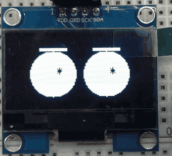
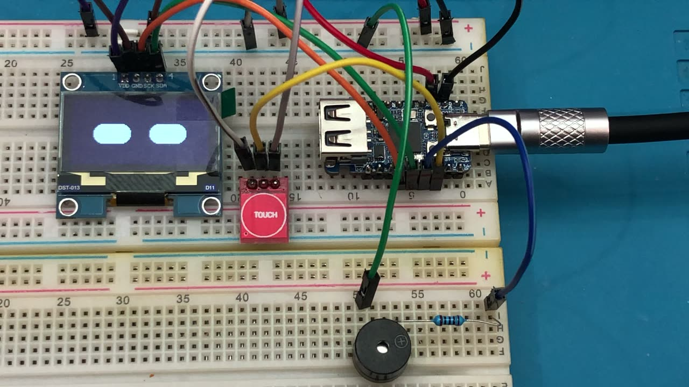
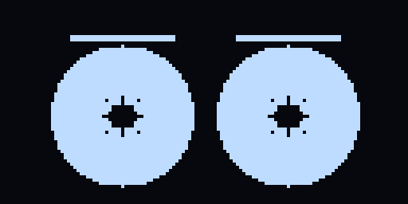

# mochi

A Dasai-Mochi-style desk robot on a **Waveshare RP2350-USB-A**, in plain C
against **Pico SDK 2.x**. No Arduino layer, no graphics library, no bitmap
frame assets — the face is drawn procedurally and only the pixels that changed
are pushed over I2C.

<p align="center">
  
</p>

Two capsule eyes, blink every 2-6 s, saccades, five moods, a yawn when it wakes
up, and a passive-piezo voice — on a breadboard, with an SH1106 OLED and a
TTP223 touch pad.

## Hardware

| Part | Notes |
|---|---|
| Waveshare RP2350-USB-A | RP2350A, 150 MHz, 520 KB SRAM, 2 MB flash |
| OLED 1.3" 128x64 | SH1106 controller, I2C, address 0x3C |
| TTP223 | capacitive touch, push-pull OUT |
| Passive piezo buzzer | a **piezo disc**, not a magnetic buzzer |
| Breadboard, jumpers | |

Wiring:

```
        RP2350-USB-A                    OLED (SH1106)
     +---------------+                 +--------------+
     |          3V3  +-----------------+  VCC         |
     |          GND  +-----------------+  GND         |
     |     GP4 (SDA) +-----------------+  SDA         |
     |     GP5 (SCL) +-----------------+  SCL         |
     |               |                 +--------------+
     |      GP2  +--------------------- TTP223 OUT
     |      GP3  +---[100R]------------ piezo +
     |          GND  ------------------ piezo -
     |   GP0/GP1     UART0 debug (optional)
     +---------------+
```

A piezo is a capacitor: the pin only charges it, current stays in the low
milliamps, so it can hang off a GPIO with just a series resistor. A **magnetic**
buzzer (coil, tens of ohms) would need an NPN/MOSFET driver and a flyback diode.

> Power through the **USB-C** port only. The USB-A plug is a PIO-USB *host*
> port; feeding 5 V into it while USB-C is connected means two supplies
> fighting.

<p align="center">
  
</p>


## What it does

**Face.** Two eyes, drawn parametrically — no frame arrays, no assets:



- blink every 2-6 s (130 ms, smooth close/open curve, occasional double blink)
- saccades: the gaze jumps to a new offset every 1-3 s and eases there in ~100 ms
- slow vertical drift so the face never looks frozen
- per-eye control, so one eyelid can move while the other stays open

Two silhouettes, picked at build time in `src/board.h`:

| `EYES_STYLE` | Look | Pixels per frame |
|---|---|---|
| 0 | capsule bars (the first face) | ~1600 |
| 1 | big circles, drawn as outlines | ~400 |
| 2 | big circles, filled | ~3900 |

On the round styles the ring stays put and only the pupil travels, which costs
a fraction of the bus time a moving eye does. `EYES_PUPIL` picks the pupil:
`0` sparkle, `1` asterisk, `2` hand-drawn asterisk, `3` plain dot, `4` fat blob
with short spikes poking out.

Expression is carried by two parameters rather than by swapping bitmaps: a
**lid** (`lid_pct`, `lid_angle`) that closes the circle like an eyelid instead
of squashing it into an ellipse, and **brows** (`brow_len`, `brow_lift`,
`brow_tilt`, `brow_thick`, `brow_mono`) drawn as a straight bar, mirrored per
eye, optionally joined into a monobrow. Thickness matters more than length:
two pixels read as a hairline at this size, three read as a brow.

**Moods**, driven purely by touch:

| Mood | Trigger | Face |
|---|---|---|
| idle | default | neutral caps, blink every 2-6 s |
| curious | one tap | wider eyes, fast gaze, 2.5 s |
| happy | two taps within 1.2 s | smile-arc eyes, 4 s |
| pleading | three taps within 2 s | brows raised and pinched at the bridge, 4 s |
| annoyed | four taps within 3 s | tilted lids, brows pulled down, 3 s |
| angry | holding the pad 1.5 s | monobrow, steeper lids, 3.5 s |
| sleepy | 45 s untouched | half-closed, slow blinks, until tapped |

The mood supplies eye parameters (openness, blink rate, saccade amplitude,
shape); the eye engine stays a dumb renderer. Shapes are procedural: a capsule
for neutral, and an ellipse-minus-ellipse crescent for smile and frown, so a
happy face still blinks correctly.

**Personality:**

- resting openness glides at 0.6 units/s, so falling asleep closes the eyes
  over about a second instead of snapping shut
- waking up triggers a yawn (squeeze shut, throw wide, settle) with a low
  falling phrase
- falling asleep plays a two-note goodnight
- every 7-16 s the face performs an involuntary gesture: a wink, or a sudden
  glance elsewhere

**Touch** (TTP223 on GP2, polled at frame rate with a 30 ms debounce): a tap pops
the eyes wide, a press past 700 ms squints them and starts a drone, release
blinks.

Holding a finger on the sensor for 2 s paints `РУКИ УБРАЛ!` along the top row.
It used to sit at the bottom, where it chewed into the chin of the eyes during
a squint; the top row is free, since the brows start at row 10. Erased the
frame the hand comes off.

**Sound** (passive piezo on GP3, PWM slice, fully non-blocking): startup
arpeggio, tap chirp, hold drone, release phrase, yawn, goodnight.

## Previewing the face without hardware

`tools/preview/` compiles the real eye engine on the host against a stub that
swallows pixels instead of pushing them over I2C:

```
cd tools/preview
make sheet        # -> preview.png, a contact sheet of nine states
make && ./preview --anim /tmp/f 2 4    # 40 frames, style 2, pupil 4
```

The eye art is the part that needs iteration, and flashing a board to look at a
4 px change is a bad loop. `docs/eye-styles.png` is the sheet; `docs/face.gif`
is `--anim` piped through ffmpeg.

## Why the pieces are hand-written

- **SH1106 driver.** U8g2 is the obvious choice, but it always blits the full
  1 KB framebuffer — it has no partial-region send on I2C. A blink then costs
  ~25 ms of bus time at 400 kHz, which is most of a 30 fps frame. The driver
  here is ~130 lines and exposes `sh1106_flush_region()`, so a blink costs two
  pages instead of eight.
- **Eye engine.** RoboEyes (FluxGarage) is Arduino-only and GPL-3.0, so nothing
  is copied from it. Drawing capsules and crescents directly is a few hundred
  lines and gives exact control over the dirty rectangle.
- **Font.** ASCII comes from the classic public-domain 5x7 fixed font, Cyrillic
  is hand-drawn in the same cell. Uppercase only: lowercase Cyrillic is
  unreadable at 5 px, so lowercase input maps to the uppercase glyphs.

## Frame budget

The SH1106 is not an SSD1306. Two differences matter:

- its RAM is **132 columns** wide and the visible 128 start at column 2, so
  every column address is biased by 2;
- there is **no horizontal addressing mode**: data is written page by page, and
  each page needs its own page+column address transaction.

At 400 kHz that makes a full frame 8 transactions and ~23 ms — too slow to do
30 times a second — while the two-page eye region costs ~6 ms. So the loop runs
at 50 fps, the eye engine reports a dirty rectangle, and frames where nothing
moved push nothing at all: roughly **4 display updates per second at idle** out
of 50 rendered frames.

## Serial output

USB CDC, or UART0 on GP0/GP1 at 115200:

```
boot: mochi M1
I2C found 0x3C
display: SH1106 @ 0x3C
fps=50 upd=4
mood: curious
touch: release 1240ms
```

`upd` is how many of those 50 frames pushed pixels to the panel. Close to `fps`
means something is moving constantly; 0 means the animation state machine is
stuck.

If the firmware runs from a power bank with no data lines, USB CDC never
enumerates and the log goes nowhere — the firmware does not block on it.

## Build

Needs CMake, Ninja and Pico SDK 2.x:

```sh
git clone https://github.com/raspberrypi/pico-sdk.git ~/pico-sdk
cd ~/pico-sdk && git submodule update --init

export PICO_SDK_PATH=~/pico-sdk
cmake -B build -G Ninja -DCMAKE_BUILD_TYPE=Release
cmake --build build -j8
```

Output: `build/mochi.uf2`.

If your `arm-none-eabi-gcc` comes from a package that builds it compiler-only
(some Homebrew formulae do — no newlib, links fail with `cannot find -lc`), point
CMake at a full toolchain instead:

```sh
export PICO_TOOLCHAIN_PATH=/path/to/xpack-arm-none-eabi-gcc
```

## Flash

1. Hold **BOOT**, plug in **USB-C**, release **BOOT**.
2. A disk named `RPI-RP2` appears.
3. Copy `build/mochi.uf2` onto it. The board reboots into the new firmware.

## Layout

```
src/
  board.h              pin map, I2C address, baud rate, eye style
  main.c               boot screen, frame loop, FPS/update counter, hold banner
  eyes.h/.c            procedural eye engine (blink, saccade, drift, yawn, wink)
  mood.h/.c            mood state machine + per-mood eye parameters
  touch.h/.c           TTP223 polled input with a debounce state machine
  buzzer.h/.c          non-blocking PWM melody player for a piezo
  display/
    sh1106.h/.c        minimal SH1106 I2C driver (full + partial flush)
    font5x7.h/.c       5x7 font, ASCII + Cyrillic, UTF-8 decoding
boards/
  waveshare_rp2350_usb_a.h   SDK board header (2 MB flash, no LED pin)
```

The custom board header exists because the stock `pico2` board declares 4 MB of
flash while this board has 2 MB, and it has no plain GPIO LED (the onboard
WS2812 sits on GP16, which is not broken out).

## Roadmap

- [x] **M0** — build, bus scan, SH1106, text, partial updates
- [x] **M1** — procedural eye engine: blink, saccades, idle drift
- [x] **M2** — TTP223 touch: tap / hold / release reactions
- [x] **M3** — passive piezo: non-blocking PWM tone player with melodies
- [x] **M4** — moods: state machine, expressions, personality, wake/sleep
- [ ] **M5** — LiPo + charger, battery monitor via ADC, deep sleep
- [ ] **M6** — two more touch sensors, so the eyes look toward the side you touch

## License

MIT — see [LICENSE](LICENSE).

The ASCII glyphs in `font5x7.c` are the classic public-domain 5x7 fixed font.
